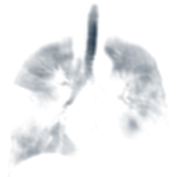

:::: {.columns}

::: {.column}
Pulmonary diseases that affect the airways and lung parenchyma have a substantial impact on the lives of millions of Canadians and even more across the world. Despite being an alarming and prevalent public health concern, currently available disease detection, management, and therapeutic intervention strategies are largely guided by self-reported symptoms, breathing tests and blood analysis. These conventional clinical measurements provide only a global estimate of lung health, making it difficult to accurately detect, localize and distinguish underlying disease pathologies.

Here at the Svenningsen Imaging Lab we are dedicated to developing non-invasive pulmonary computed tomography and magnetic resonance imaging measurements that are highly sensitive to pathological changes in the airways, lung parenchyma, and pulmonary vasculature to improve pulmonary disease outcomes. The overall goals of our program are to **detect** and better understand the mechanisms of pulmonary diseases, predict and **evaluate** pulmonary disease outcomes, and improve the selection, delivery and efficacy of **therapies** targeting pulmonary diseases.

Our lab is located in Firestone Institute for Respiratory Health, based out of St. Joseph's Healthcare Hamilton in Ontario, Canada where we are privileged to work alongside exceptional basic science and clinical expertise. Our patient-centric research approach is focused on translating advanced imaging techniques into the clinic and improving patient outcomes. We welcome collaborations, feedback, and new research partners. Please look around this website for a taste of the research we perform and reach out should you have any questions or a topic to discuss.
:::

::: {.column}
{width=90% fig-align="center" fig-alt="Xenon-129 MRI of the lungs of a person with asthma, showing patchy areas of reduced ventilation signal."}
:::

::::
