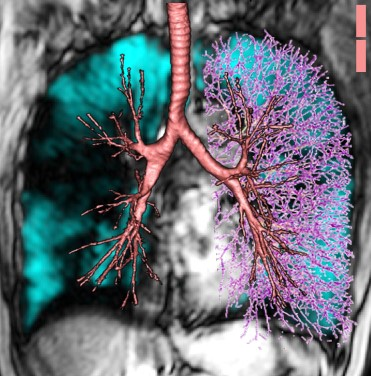

:::: {.columns}

::: {.column}
The Svenningsen Imaging Lab develops and applies pulmonary MRI and CT to measure lung structure and function in people with asthma, COPD and other chronic lung diseases. Our work focuses on imaging biomarkers that detect regional disease, such as ventilation defects, gas exchange impairment, air trapping, and airway mucus plugging. We use these measures to characterize disease phenotypes, track the effects of treatment, and predict clinical outcomes.

## Our imaging approaches

- [Hyperpolarized ^129^Xe MRI](research/xenon-mri.qmd)
- [Quantitative CT](research/CT.qmd)
- [Free-breathing ^1^H MRI](research/proton-mri.qmd)
- [FIRH Imaging Registry](research/FIRe.qmd)
:::

::: {.column}
{width=90% fig-align="center" fig-alt="Two researchers preparing a participant, with a chest coil in place, to enter an MRI scanner."}
:::

::::
