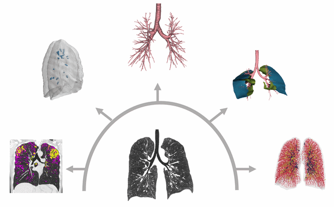

Quantitative CT uses image analysis software to extract measurements from a standard chest CT. We segment the airway tree to measure lumen area and wall thickness, and we quantify air trapping from expiratory and inspiratory scans using low-attenuation area and parametric response mapping. We also score mucus plugs by number and location, and we measure the pulmonary vasculature, including blood vessel volume and the size distribution of the vessels.

CT gives high-resolution structural detail, while MRI gives functional information, so we analyze them together within the same participant. For example, we ask how airways blocked by mucus on CT relate to ventilation defects on ^129^Xe MRI, and how both change with treatment. This helps us link structural abnormalities in the airways and lung vessels to regional lung function in asthma and COPD.

{width=50% fig-align="center" fig-alt="Animated CT lung images showing parenchyma, mucus plugs, airways, fissures and pulmonary vessels derived from a single scan."}

## Selected publications

::: {#refs}
:::
