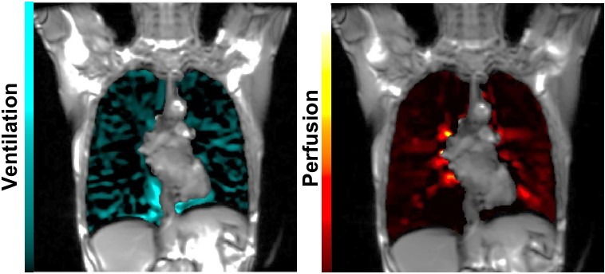
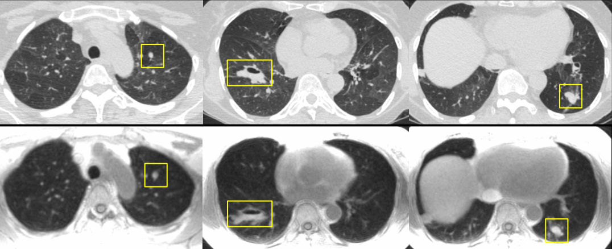

:::: {.columns}
::: {.column}
^1^H MRI refers to the conventional MRI signal acquired on standard clinical scanners. Although the ^1^H signal in the lungs is very sparse, we can acquire the signal over minutes of free-breathing to produce images of pulmonary structure and function that require no exogenous contrast agent. Methods such as PREFUL (phase-resolved functional lung MRI) then register the images to a common respiratory phase and use the signal changes with breathing and the cardiac cycle to produce regional maps of ventilation and perfusion. Other methods, such as ultrashort echo time (UTE) MRI, capture the fast-decaying lung signal and allow us to acquire structural images that resemble CT images, albeit at lower resolution.

Since the method needs no specialized gas hardware, it could be much easier to use in routine care and in larger multicentre studies. In the lab, we evaluate how well these images detect abnormal ventilation and perfusion, compare them with ^129^Xe MRI and CT, and test whether they change with treatment.

## Selected publications

::: {#refs}
:::
:::
::: {.column}
{width=100% fig-align="center" fig-alt="Colour-coded PREFUL ventilation and perfusion maps of the lungs."}

{width=100% fig-align="center" fig-alt="Matching CT and UTE MRI lung images from a patient with asthma showing similar opacities."}
:::
::::
