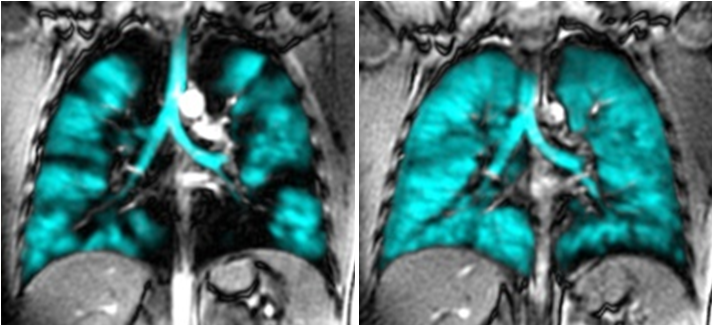
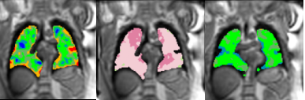

:::: {.columns}
::: {.column}
Because the lungs are mostly air, conventional MRI gives little signal from them. Hyperpolarized ^129^Xe is a safe, radiation-free contrast agent that a person can inhale; during a short breath-hold, the scanner maps its distribution within the lungs. Regions the gas can't reach appear as ventilation defects, and the ventilation defect percent (VDP) quantifies the fraction of lung affected.

^129^Xe is also soluble in lung tissue and blood, and its signal shifts in frequency depending on where it is. By separately detecting gas in the airspaces, in the tissue, and in red blood cells, we can measure gas exchange, meaning how efficiently ^129^Xe moves from the alveoli into the pulmonary capillaries. This technique is sensitive to different pathologies that affect gas exchange, such as emphysema, parenchymal inflammation, and collapse of the capillary vessels.

^129^Xe gas in the lung is constantly moving in random thermal motion, and the walls of the alveoli limit how far it can travel during a short measurement. By applying diffusion-weighting gradients, we can measure this restricted motion. When the airspaces are enlarged, for example in emphysematous lungs, the motion of the gas is less restricted. This informs us about the alveolar morphology and lets us assess tissue changes at a scale far smaller than the image resolution.

We apply this to clinical and observational trials examining how ventilation and gas-exchange change with treatment and disease progression. Our primary focus is obstructive lung diseases such as asthma and COPD, but we have also studied ventilation defects before lung cancer surgery, where they predicted postoperative complications and length of stay better than standard lung function tests.

## Selected publications

::: {#refs}
:::
:::

::: {.column}
{width=70% fig-align="center" fig-alt="Two coronal xenon-129 MRI lung slices before and after treatment: ventilation (cyan) is patchy before and more uniform after."}

{width=80% fig-align="center" fig-alt="Three colour-coded xenon-129 MRI lung images showing the gas, tissue and red blood cell signals."}

{width=65% fig-align="center" fig-alt="Two diffusion xenon-129 MRI maps, one of a healthy lung and one of an emphysematous lung."}
:::
::::
